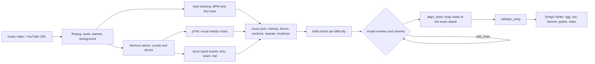

# AI-driven rhythm game

**English** | [简体中文](README.md)

A fork of [Etterna](https://github.com/etternagame/etterna) in which a language model writes the
charts. Give it a music video: it listens to the song, looks at the chart it drafted, reworks the
choreography, and the result is a playable 7-key song in a hand-inked "record shop" UI.

| Select a record | Play |
|---|---|
|  |  |

(The song in the screenshots is a concert video; songs are not part of this repository.)

This README covers what this fork adds. The original Etterna README follows below it.

## What changed compared with upstream Etterna

### 1. `video2sm/`: an MCP server that makes songs (new)

A Python [MCP](https://modelcontextprotocol.io) server. It turns a music video into a song folder
and gives the model tools to choreograph the chart. How it works is explained
[below](#how-the-mcp-server-works) and in [`video2sm/README.md`](video2sm/README.md).

### 2. `Themes/O2Jam/`: a new theme (new)

A theme that falls back to Rebirth, so every screen it does not replace (title, options, results...)
is stock Rebirth. It replaces two screens.

**Gameplay** (`BGAnimations/ScreenGameplay underlay.lua`, `ScreenGameplay overlay/`)

- A fixed 960x720 (4:3) layout: seven 48px lanes on the left (the noteskin's 64px columns drawn at
  zoom 0.75), the song's video in a wooden frame on the right, a judgment table below it and a
  score / progress / accuracy / rank bar along the bottom. Layout numbers live in
  `Scripts/90 O2Jam.lua` and must agree with `metrics.ini`.
- Judgments are drawn by the HUD (`hud.lua`), not by Etterna's Player graphics: the five Etterna windows
  collapse to **COOL** (W1, W2), **GOOD** (W3, W4), **BAD** (W5) and **MISS**. Each shows in a
  speech bubble that fades out and drifts up, with a short halftone light beam, a burst and ring on the
  key and confetti. Combo numbers change colour and size with the combo, and every 25 combo shows a small
  banner. Text effects sit at the top of the lanes so they never cover the notes falling onto the
  judgment line.
- Scoring and rank rules are in `Scripts/91 O2State.lua`, pure data in / data out with no actors,
  tested with LuaJIT (`tools/lua/test_state.lua`).
- The window keeps its 4:3 ratio when resized (a C++ change, see below); the screen scales up as a whole.
- The lead-in before the first note is shortened (`MinSecondsToStep=3`, `MinSecondsToMusic=1`; the
  engine default is 6 and 2).
- The stock life bar is replaced by an energy column.

**Select music** (`BGAnimations/ScreenSelectMusic decorations/`, `underlay`, `overlay`)

- A crate of records. The current sleeve stands in front, records already flipped past recede behind it
  up and to the right, and the next one rises from the tray. It reuses Rebirth's `MusicWheel` (its input,
  packs, sorting and selection), so only the look and the positions are new
  (`wheel.lua`, `crate.lua`, `info.lua`).
- Left / Right browse, **Up / Down change the difficulty**, Enter plays, Esc goes back.
- The right side shows artist, title, stars, the difficulties of the record on top (with levels) and its BPM,
  length and note count. Sleeves use the song's jacket, banner or background.
- Chinese titles: Etterna's bundled font misses many CJK characters, so video2sm writes `title.png` and
  `artist.png` into each song folder and the theme shows those when present.
- Rebirth's header bar (profile and settings tabs) is not shown on this screen.

**Assets** are generated, not hand-edited: `tools/make_ink_assets.py` (panels, wall, sleeves, tray, beams,
bubbles...; hand-inked outlines drawn at 4x and shrunk), `tools/comicfont.py` (the Marker, Scrawl and
Poster bitmap fonts, white face with an ink outline so `diffuse` tints only the face),
`tools/make_ink_noteskin.py`. Texture names under `Graphics/ink` must not be prefixes of each other (the
engine refuses ambiguous theme elements).

### 3. `NoteSkins/kb7/ink/`: a vinyl noteskin (new)

Notes are spinning records with a teal, coral or mustard label (matching the lane tints), holds are
ribbons with rounded ends, and the receptors are record slots.

### 4. Engine and upstream fixes (changed)

- `src/arch/LowLevelWindow/LowLevelWindow_MacOSX.mm`: `setContentAspectRatio` on the window, so resizing
  keeps the aspect ratio instead of stretching.
- `NoteSkins/popn/default/Key Tap Lift.lua`: a missing comma that stopped the popn skin from loading.

## How the MCP server works

The idea: **code gives the model senses and checks; the model makes the artistic decisions.**
A chart is a dance for the fingers on a simplified MIDI keyboard. Code can line notes up with onsets, but
what makes a chart feel musical (a rhythm shape that repeats, finger paths that follow the melody, rests
where the music rests, the same moves when the chorus returns) is judgement. So the draft is generated by
code and then reworked by the model with tools.

1. **Hearing.** `ffmpeg` extracts the audio. Beat analysis finds the BPM and first beat. With the optional
   `stems` extra, Demucs separates vocals and drums; the vocal line is transcribed into notes (pitch,
   onset, length) and kick / snare / hi-hat hits are read from the drum stem. Section boundaries and repeated
   passages (a chorus that returns) are detected. Everything is written to `music.json` next to the chart.
2. **Draft.** Each melody note becomes a chart note on its sung onset, in the lane its pitch maps to
   (higher pitch, further right); long sung notes become holds; drum hits fill in around the vocal line,
   more of them as the difficulty rises. Without Demucs the draft is built from onsets in the full mix.
3. **Review loop (the model).**
   - *Reading*: `inspect_chart` prints measures next to the music they follow, which measures sound alike,
     and stats (density against the difficulty's target, rhythm regularity, moves beyond comfortable reach).
   - *Eyes*: `view_chart` renders a picture of the chart beside the melody and drums, `look_at_video` a
     contact sheet of frames.

     

     (Time runs downward. Left: the sung melody; middle: the seven lanes with the chart; right: kick, snare, hat.)
   - *Knowledge*: `choreography_guide` explains what a good chart feels like and the working method.
   - *Hands*: `edit_chart` rewrites measures, copies a measure, repeats a whole section (so a reprised
     chorus gets the same choreography), clears measures. Edits that cannot be played (open holds, a lane pressed
     while held, more than two keys at once) are refused and change nothing; density, leaps and notes with
     nothing to hear are reported as warnings. `dry_run` checks without writing.
4. **Align.** `align_chart` keeps every choreographic choice and only nudges timing: each note moves onto the
   sung attack or drum hit it answers (within a tolerance), and each hold ends where the sung note ends.
5. **Validate and install.** `validate_song` re-parses the `.ssc` and checks timing and files. Songs are written to
   `Songs/<pack>/<title>/` with the audio, charts for each difficulty, banner, a square jacket, the video as the
   in-game background and the title cards; reload songs in the game to see them.

The same review tools are available from a shell as `video2sm-review inspect | view | frames | edit | align | merge`, for
agents without MCP. Several sub-agents can each rework one difficulty in a copy of the song and `merge` brings the
results back.

### Quick start (macOS)

1. Build as for upstream Etterna (the build path must not contain spaces, or FFmpeg's configure fails).
2. In `Save/Preferences.ini` set `Theme=O2Jam`, `CurrentGame=kb7`, `DisplayAspectRatio=1.333333`,
   `DisplayHeight=720`. The default kb7 keys are S D F Space J K L. In the profile's kb7 modifiers use the `ink` noteskin.
3. Install video2sm: `cd video2sm && uv sync` (add `--extra stems` for Demucs), then register it with your MCP
   client, for example `claude mcp add video2sm -e VIDEO2SM_SONGS_DIR=/path/to/Songs -- "$PWD/.venv/bin/video2sm-mcp"`.
   Requires `ffmpeg` on `PATH`.
4. Ask the model to make a song from a video file or a URL, then reload songs in the game (delete `Cache/cache.db`
   if a song you overwrote does not refresh).

Songs, saves and builds are not part of this repository. Only use video you have the right to use:
`make_song_from_url` requires a `rights_basis` and records it, but does not verify it.

### Developing the theme without a keyboard

If `Save/o2jam_dev.txt` exists, the theme's `ScreenSystemLayer overlay` walks title, select and gameplay by itself.
Lines: `difficulty=Easy`, `autoplay=1`, `fakefx=1` (scripted judgments to see every effect), `stop=ScreenSelectMusic`,
`moves=1,s,1,d` (move the wheel, `s` selects, `d` next difficulty). Delete the file afterwards, or the game keeps
driving itself.

---

    

    
    
    
    
    

    
    

Etterna is a cross-platform rhythm game similar to [Dance Dance Revolution](https://en.wikipedia.org/wiki/Dance_Dance_Revolution). It started as a fork of [StepMania 5](https://github.com/stepmania/stepmania) (v5.0.12), with a focus on keyboard players. Over time, Etterna evolved into its own game, with in-game multiplayer, the online scoreboard [Etterna Online](https://etternaonline.com/), and a community of over 4,000 players.

## Table of Contents

- [Installing](#Installing)
  - [Windows and macOS](#Windows-and-macOS)
  - [Linux](#Linux)
- [Building](#Building)
- [Documentation](#Documentation)
- [Bug Reporting](#Bug-Reporting)
- [Contributing](#Contributing)
- [License](#License)
- [Special Thanks](#Special-Thanks)

## Installing

### Windows, macOS, and Linux

Head to the [GitHub Releases](https://github.com/etternagame/etterna/releases) page, and download the relevant file for your operating system.

For Windows, run the installer, and you should be ready to go.

For macOS, first follow the below instructions. *After* doing them, mount the DMG and copy the Etterna folder to a location of your choice. Run the executable, and you are ready to go.

For Linux, there should be no extra steps. If it does not work, try to follow the build instructions to install the necessary dependencies.

### macOS

This macOS binary is not signed, so before it can be installed it must be de-quarantined by executing this command in the same directory (likely your downloads folder) as the Etterna dmg.

`xattr -d com.apple.quarantine ./Etterna*.dmg`

## Building

All details related to building are in the [Building.md](Docs/Building.md) file. Since Etterna is cross-platform, you should be able to build on any recent version of Windows, macOS, or Linux.

## Documentation

Etterna uses Doxygen and LuaDoc. Both still need a lot of work before being having decent coverage, though we still have them hosted at the following links.  

Any commit to the develop branch immediately updates these documentation sites which can be found [here](https://docs.etterna.dev/).

- Latest C++ documentation: [https://docs.etterna.dev/doxygen/html/index.html](https://docs.etterna.dev/doxygen/html/index.html)
- Latest Lua documentation: [https://docs.etterna.dev/ldoc/index.html](https://docs.etterna.dev/ldoc/index.html)

## Bug Reporting

We use GitHub's [issue tracker](https://github.com/etternagame/etterna/issues) for all faults found in the game. If you would like to report a bug, please click the `Issues` tab at the top of this page, and use the `Bug report` template.

## Contributing

If you want to contribute to the Etterna client, please read [Building](Docs/Building.md) for instructions on how to get started. We have a variety of different tasks which would help the development of this game as a whole, all of which we have listed at [Contributing.md](Docs/Contributing.md). if you are more interested in helping with the in-game multiplayer, the nodejs server, along with its documentation, is hosted [here](https://github.com/etternagame/NodeMultiEtt). You will still need the Etterna client built and running on your system.

If there is something else you want to work on that we don't have listed here, feel free to join [Etterna Dev Group](https://discord.gg/ZqpUjsJ), our development discord, and let us know what you want to add. The developers and contributors there would be able to give you a hand as to where you could start doing what you want to do.  

## License

Etterna uses the MIT License, as is required since we are derivative of StepMania 5. See [LICENSE](LICENSE) for more details.

In short, you are free to modify, sell, distribute, and sublicense this project. We ask that you include a reference to this GitHub repository in your derivative, and do not hold us liable when something breaks.

Etterna uses the [MAD library](http://www.underbit.com/products/mad/) and [FFMPEG codecs](https://www.ffmpeg.org/). Those libraries, when built, use the [GPL license](http://www.gnu.org).

## Special Thanks

- All original SM devs/contributors
- [Jet Brains](https://www.jetbrains.com/?from=Etterna) for giving us free licenses
- [Coverity](https://scan.coverity.com/) for giving us free scans
