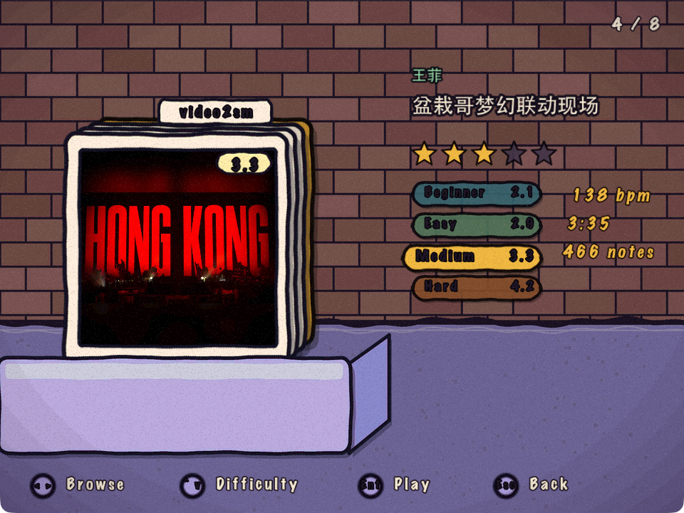
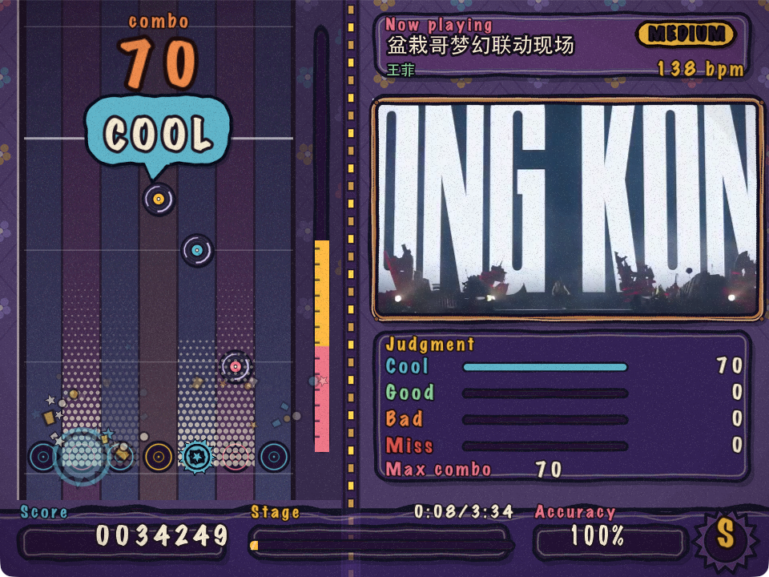
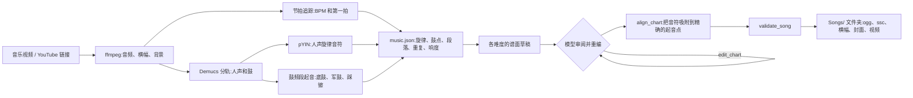
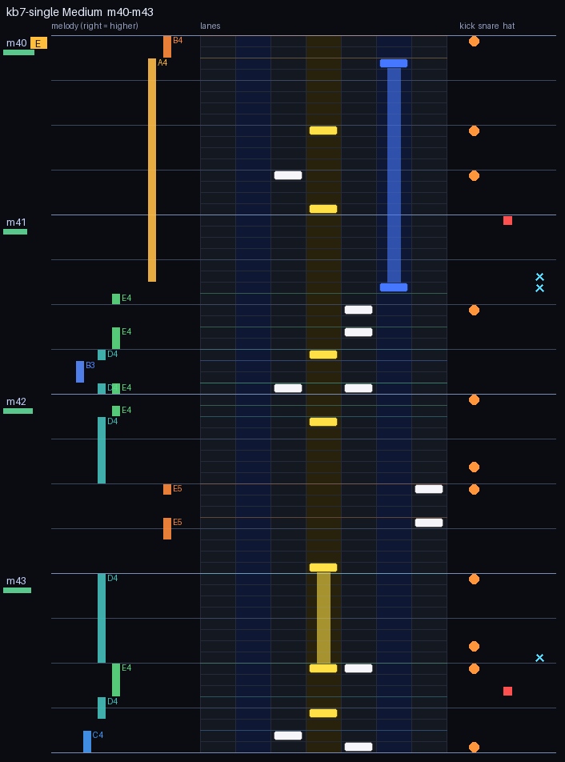

# AI 驱动的律动游戏

[English](README.md) | **简体中文**

这是 [Etterna](https://github.com/etternagame/etterna) 的一个分支,谱面由语言模型来写。给它一段音乐视频:它会听歌,
看自己起草的谱面,再重新编排,最终得到一首可以直接玩的 7 键歌曲,界面是手绘风格的"唱片店"。

| 选歌:一箱唱片 | 游戏中 |
|---|---|
|  |  |

(截图里的歌曲来自一段演唱会视频。歌曲不包含在本仓库中。)

本文介绍这个分支新增的内容。原版 Etterna 的 README 内容见文末。

## 与上游 Etterna 相比的改动

### 1. `video2sm/`:制作歌曲的 MCP 服务器(新增)

一个 Python [MCP](https://modelcontextprotocol.io) 服务器。它把音乐视频转成歌曲文件夹,并提供一组工具,让模型亲自编排谱面。
工作原理见[下文](#mcp-服务器如何工作)和 [`video2sm/README.md`](video2sm/README.md)。

### 2. `Themes/O2Jam/`:新主题(新增)

这个主题回退到 Rebirth,所以它没有替换的界面(标题、选项、结算等)都是原版 Rebirth。它替换了两个界面。

**游戏界面**(`BGAnimations/ScreenGameplay underlay.lua`、`ScreenGameplay overlay/`)

- 固定 960x720(4:3)布局:左侧是七条 48px 宽的轨道(noteskin 的 64px 列以 0.75 倍缩放绘制),右侧是装在木框里的歌曲视频,
  下方是判定表,底部是分数 / 进度 / 准确率 / 评级条。布局数值在 `Scripts/90 O2Jam.lua` 中,必须与 `metrics.ini` 保持一致。
- 判定由 HUD(`hud.lua`)绘制,而不是 Etterna 自带的 Player 图形:Etterna 的五档判定合并为 **COOL**(W1、W2)、
  **GOOD**(W3、W4)、**BAD**(W5)和 **MISS**。每次判定显示在一个对话气泡里,气泡淡出并上飘,同时伴有短暂的网点光束、
  按键上的爆裂和光环,以及彩纸。连击数字的颜色和大小随连击变化,每 25 连击弹出一个小横幅。文字特效放在轨道顶部,
  不会遮住落向判定线的音符。
- 计分和评级规则在 `Scripts/91 O2State.lua` 中,纯数据输入 / 数据输出,不含 actor,用 LuaJIT 测试(`tools/lua/test_state.lua`)。
- 调整窗口大小时保持 4:3 比例(这是一处 C++ 改动,见下文);整个画面随之整体缩放。
- 缩短了第一个音符之前的前奏(`MinSecondsToStep=3`,`MinSecondsToMusic=1`;引擎默认值为 6 和 2)。
- 原版生命条被替换为能量柱。

**选歌界面**(`BGAnimations/ScreenSelectMusic decorations/`、`underlay`、`overlay`)

- 一箱唱片。当前这张唱片套在最前面,已经翻过去的唱片向右上方退到它后面,下一张从托盘里升起。它复用了 Rebirth 的
  `MusicWheel`(输入、曲包、排序和选择逻辑都沿用),只有外观和位置是新的(`wheel.lua`、`crate.lua`、`info.lua`)。
- 左 / 右浏览,**上 / 下切换难度**,Enter 开始游玩,Esc 返回。
- 右侧显示最上面那张唱片的艺术家、标题、星级、各难度(含等级),以及 BPM、时长和音符数。唱片封套使用歌曲的封面、横幅或背景图。
- 中文标题:Etterna 自带字体缺少很多中日韩字符,所以 video2sm 会在每个歌曲文件夹里写入 `title.png` 和 `artist.png`,
  主题在它们存在时优先显示这两张图。
- 这个界面不显示 Rebirth 的顶栏(个人资料和设置标签页)。

**素材**是生成的,不要手工编辑:`tools/make_ink_assets.py`(面板、墙面、封套、托盘、光束、气泡等;手绘风轮廓先以 4 倍大小绘制再缩小)、
`tools/comicfont.py`(Marker、Scrawl、Poster 位图字体,白色字面加墨色轮廓,这样 `diffuse` 只会给字面上色)、
`tools/make_ink_noteskin.py`。`Graphics/ink` 下的贴图名称不能互为前缀(引擎会拒绝有歧义的主题元素)。

### 3. `NoteSkins/kb7/ink/`:黑胶唱片 noteskin(新增)

音符是旋转的唱片,标签为青绿、珊瑚红或芥末黄(与轨道的色调对应);长条(hold)是两端圆润的丝带;接收器(receptor)是唱片槽。

### 4. 引擎与上游修复(修改)

- `src/arch/LowLevelWindow/LowLevelWindow_MacOSX.mm`:给窗口设置 `setContentAspectRatio`,调整大小时保持宽高比,而不是拉伸。
- `NoteSkins/popn/default/Key Tap Lift.lua`:补上一个缺失的逗号,它曾导致 popn 皮肤无法加载。

## MCP 服务器如何工作

核心思路:**代码给模型提供感知和检查,艺术上的决定由模型来做。**
谱面是为手指编排的、在简化 MIDI 键盘上的一支舞。代码可以把音符对齐到起音点,但谱面是否有音乐感(反复出现的节奏型、
跟随旋律的指法路径、音乐休止时的留白、副歌回来时重复同样的动作)靠的是判断力。所以草稿由代码生成,再由模型用工具重新打磨。

1. **听。** `ffmpeg` 提取音频。节拍分析找出 BPM 和第一拍。安装可选的 `stems` 额外依赖后,Demucs 会分离人声和鼓;
   人声线被转写成音符(音高、起音、长度),底鼓 / 军鼓 / 踩镲的敲击则从鼓轨中读出。还会检测段落边界和重复的乐段(回来的副歌)。
   所有结果写入谱面旁边的 `music.json`。
2. **起草。** 每个旋律音符变成谱面上位于演唱起音点的一个音符,所在轨道由音高决定(音越高越靠右);长音变成长条;
   鼓点围绕人声线填充,难度越高填得越多。没有 Demucs 时,草稿由完整混音里的起音点生成。
3. **审阅循环(模型)。**
   - *读*:`inspect_chart` 把各小节与它们所跟随的音乐并排打印出来,标出哪些小节听起来相似,并给出统计数据
     (相对于该难度目标的密度、节奏规律性、超出舒适范围的移动)。
   - *看*:`view_chart` 画出谱面与旋律、鼓点并排的图片,`look_at_video` 给出视频帧的缩略图拼板。

     

     (时间向下流动。左:演唱的旋律;中:七条轨道及谱面;右:底鼓、军鼓、踩镲。)
   - *知识*:`choreography_guide` 讲解好谱面该有的感觉和工作方法。
   - *动手*:`edit_chart` 重写小节、复制小节、重复整个段落(让重现的副歌得到同样的编排)、清空小节。无法演奏的编辑
     (未闭合的长条、按住时又按同一轨道、同时按下超过两个键)会被拒绝且不产生任何改动;密度、跳跃过大和没有声音对应的音符
     会作为警告报告。`dry_run` 只检查不写入。
4. **对齐。** `align_chart` 保留所有编排上的选择,只微调时间:每个音符移动到它所对应的演唱起音点或鼓点上(在容差范围内),
   每个长条在对应的演唱音符结束处结束。
5. **验证并安装。** `validate_song` 重新解析 `.ssc` 并检查时间和文件。歌曲写入 `Songs/<曲包>/<标题>/`,
   包含音频、各难度谱面、横幅、方形封面、作为游戏内背景的视频,以及标题卡;在游戏中重新加载歌曲即可看到。

同样的审阅工具也可以在 shell 里以 `video2sm-review inspect | view | frames | edit | align | merge` 的形式使用,供不支持 MCP 的
agent 调用。多个子 agent 可以各自在歌曲的副本里重编一个难度,再用 `merge` 把结果合并回来。

### 快速开始(macOS)

1. 按上游 Etterna 的方式编译(构建路径不能含空格,否则 FFmpeg 的 configure 会失败)。
2. 在 `Save/Preferences.ini` 中设置 `Theme=O2Jam`、`CurrentGame=kb7`、`DisplayAspectRatio=1.333333`、
   `DisplayHeight=720`。kb7 默认按键为 S D F 空格 J K L。在个人资料的 kb7 修饰项里选择 `ink` noteskin。
3. 安装 video2sm:`cd video2sm && uv sync`(加上 `--extra stems` 安装 Demucs),然后注册到你的 MCP 客户端,例如
   `claude mcp add video2sm -e VIDEO2SM_SONGS_DIR=/path/to/Songs -- "$PWD/.venv/bin/video2sm-mcp"`。
   需要 `ffmpeg` 在 `PATH` 中。
4. 让模型用视频文件或链接做一首歌,然后在游戏里重新加载歌曲(如果覆盖过的歌曲没有刷新,删除 `Cache/cache.db`)。

歌曲、存档和构建产物不包含在本仓库中。请只使用你有权使用的视频:`make_song_from_url` 要求填写 `rights_basis` 并记录下来,
但不会验证它。

### 不用键盘开发主题

如果存在 `Save/o2jam_dev.txt`,主题的 `ScreenSystemLayer overlay` 会自己依次走过标题、选歌和游戏界面。
可用的行:`difficulty=Easy`、`autoplay=1`、`fakefx=1`(用脚本触发判定,以查看每种特效)、`stop=ScreenSelectMusic`、
`moves=1,s,1,d`(移动曲目轮盘,`s` 选择,`d` 切换到下一个难度)。用完请删除该文件,否则游戏会一直自己操作。

---

    

## 关于 Etterna(上游项目)

Etterna 是一款跨平台节奏游戏,类似 [Dance Dance Revolution](https://en.wikipedia.org/wiki/Dance_Dance_Revolution)。
它最初是 [StepMania 5](https://github.com/stepmania/stepmania)(v5.0.12)的分支,专注于键盘玩家。后来 Etterna 逐渐发展成独立的游戏,
带有游戏内多人联机、在线成绩榜 [Etterna Online](https://etternaonline.com/),以及超过 4000 名玩家的社区。

### 安装

**Windows、macOS 和 Linux:** 前往 [GitHub Releases](https://github.com/etternagame/etterna/releases) 下载适合你操作系统的文件。

- Windows:运行安装程序即可。
- macOS:先按下面的说明处理,*之后*挂载 DMG,把 Etterna 文件夹复制到你选择的位置,运行可执行文件即可。
- Linux:无需额外步骤。如果无法运行,可按构建说明安装必要的依赖。

**macOS 注意:** 该 macOS 二进制文件未签名,安装前必须解除隔离。在 Etterna dmg 所在目录(通常是下载文件夹)执行:

`xattr -d com.apple.quarantine ./Etterna*.dmg`

### 构建

构建的全部细节见 [Building.md](Docs/Building.md)。Etterna 是跨平台的,你应该可以在任何较新版本的 Windows、macOS 或 Linux 上构建。

### 文档

Etterna 使用 Doxygen 和 LuaDoc,两者的覆盖率都还有很大提升空间,但仍托管在以下链接。develop 分支的任何提交都会立即更新这些文档站点,
入口在[这里](https://docs.etterna.dev/)。

- 最新 C++ 文档:[https://docs.etterna.dev/doxygen/html/index.html](https://docs.etterna.dev/doxygen/html/index.html)
- 最新 Lua 文档:[https://docs.etterna.dev/ldoc/index.html](https://docs.etterna.dev/ldoc/index.html)

### 报告 Bug

游戏中发现的所有问题都使用 GitHub 的 [issue 跟踪器](https://github.com/etternagame/etterna/issues)。要报告 Bug,请点击页面顶部的
`Issues` 标签,并使用 `Bug report` 模板。

### 参与贡献

如果你想为 Etterna 客户端做贡献,请先阅读 [Building](Docs/Building.md) 了解如何入手。我们列出了各种有助于游戏整体开发的任务,
见 [Contributing.md](Docs/Contributing.md)。如果你更想帮忙做游戏内多人联机,nodejs 服务器及其文档托管在
[这里](https://github.com/etternagame/NodeMultiEtt),你仍然需要在本机构建并运行 Etterna 客户端。

如果你想做的事情不在我们的列表里,欢迎加入开发者 Discord [Etterna Dev Group](https://discord.gg/ZqpUjsJ) 告诉我们,
那里的开发者和贡献者可以告诉你从哪里开始。

### 许可证

由于我们是 StepMania 5 的衍生作品,Etterna 使用 MIT 许可证,详见 [LICENSE](LICENSE)。

简而言之,你可以自由地修改、销售、分发和再授权本项目。我们希望你在衍生作品中附上本 GitHub 仓库的引用,并且在出问题时不要追究我们的责任。

Etterna 使用 [MAD 库](http://www.underbit.com/products/mad/)和 [FFMPEG 编解码器](https://www.ffmpeg.org/),这些库在构建后适用 [GPL 许可证](http://www.gnu.org)。

### 特别感谢

- 所有 StepMania 原始开发者 / 贡献者
- [Jet Brains](https://www.jetbrains.com/?from=Etterna) 提供免费许可证
- [Coverity](https://scan.coverity.com/) 提供免费扫描
